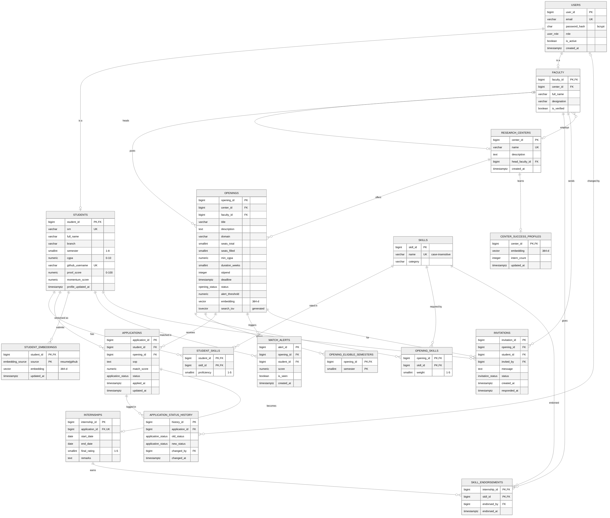
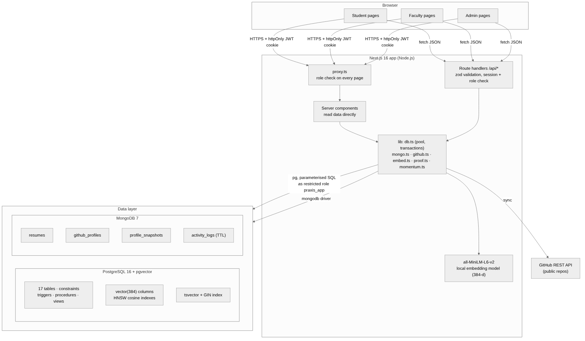

# Praxis: Project Report

**Proof-based research talent matching**
DBMS Experiential Learning, Level 3 Project

| | |
|---|---|
| Stack | Next.js 16 · PostgreSQL 16 + pgvector · MongoDB 7 |
| Repository |https://github.com/GTX-Pradeep/praxis.git |

---

## Contents

1. [Problem statement](#1-problem-statement)
2. [Objectives](#2-objectives)
3. [Scope](#3-scope)
4. [Functional requirements](#4-functional-requirements)
5. [ER diagram](#5-er-diagram)
6. [Relational schema](#6-relational-schema)
7. [Database choice and justification](#7-database-choice-and-justification)
8. [Data dictionary](#8-data-dictionary)
9. [SQL, NoSQL and vector implementation](#9-sql-nosql-and-vector-implementation)
10. [Important queries](#10-important-queries)
11. [System architecture](#11-system-architecture)
12. [Application screenshots](#12-application-screenshots)
13. [Testing results](#13-testing-results)
14. [Conclusion and future enhancements](#14-conclusion-and-future-enhancements)
15. [Team contributions](#15-team-contributions)

Supporting documents: [data dictionary](data-dictionary.md) · [important queries](queries.md) · [test cases](testing.md) · [semantic matching](semantic-matching.md) · [demo guide](demo-guide.md)

---

## 1. Problem statement

University research centres recruit student interns informally. A professor forwards a PDF or a message in a group; students reply with a resume; the professor reads a pile of self-written claims ("proficient in PyTorch") and picks based on CGPA and gut feel. This causes four problems:

1. **Claims can't be checked.** A resume says what a student *says* they can do, not what they have done. Copied projects and forked repositories look the same as original work.
2. **Good students are missed.** A strong second-year student who never saw the message, or didn't think to apply, is invisible.
3. **Labs don't learn.** When an intern turns out excellent, nothing about that outcome feeds into the next selection.
4. **Everything is one-off.** Each call for interns starts from scratch, though students and labs stay at the same university for years.

**Praxis** is a permanent platform where students keep a growing profile and labs keep live requirements. It ranks students by **proven** work rather than claims:

- **Proof-of-work** from GitHub history: original repositories, the student's own commits, and steady activity over months, so forks and one-night commit dumps score low.
- **Faculty-endorsed skills**: after an internship, the supervisor verifies specific skills, and verified skills count double in matching.
- **Learning from outcomes**: each lab gets a *success profile*, the average vector of its interns rated 4 or 5, and new candidates are compared against it.
- **Matching by meaning**: openings, resumes and repositories are embedded as vectors, so "deep learning on brain scans" finds "MRI tumour segmentation".
- **Always on**: when a student's profile grows into a match, the lab is alerted, and faculty can invite strong candidates who never applied.

The data is genuinely of three kinds: strictly related records (accounts, openings, applications, seats), loosely structured documents (resumes, GitHub snapshots, monthly history), and vectors. Each is stored in the database paradigm built for it (section 7).

## 2. Objectives

1. Design a normalised relational schema for users, labs, openings, applications and internships, with all business rules enforced **inside the database** (constraints, triggers, procedures), not only in the application.
2. Make the selection process safe under concurrency: two students can never take the last seat, and every status change is audited.
3. Store and analyse semi-structured profile data (resumes, GitHub repositories, monthly snapshots) in MongoDB using validators and aggregation pipelines.
4. Implement semantic search and ranking with vector embeddings in pgvector, combined with relational filters in a single query.
5. Build a role-based Next.js web application (admin, faculty, student) on top of an API layer, with secure authentication.
6. Show that the system gets better with use: ratings and endorsements feed back into future rankings.

## 3. Scope

**In scope**

- Three roles with separate dashboards: admin, faculty, student.
- Faculty and lab registration with admin verification; a faculty member can create a new lab and becomes its head.
- Openings with weighted skills, seats, minimum CGPA, eligible semesters, deadline and alert threshold.
- Student profile: skills with proficiency, resume PDF upload (text extracted and sectioned), GitHub sync.
- Proof-of-work and momentum scores; hybrid match score; ranked candidate lists, including students who haven't applied.
- Application lifecycle `applied → shortlisted → offered → accepted` (or rejected/withdrawn), offer acceptance as a transaction, internship completion with rating and skill endorsements.
- Lab success profiles, match alerts, invitations, analytics dashboards.
- Full-text and semantic search over openings.

**Out of scope**

- Email or push notifications (alerts and invitations are shown in the app).
- Private GitHub repositories (only public data is read; no OAuth).
- Interview scheduling, payments of stipends, and university ERP integration.
- Production deployment and horizontal scaling (the project runs locally with Docker).

## 4. Functional requirements

| ID | Role | Requirement |
|---|---|---|
| FR1 | All | Register and log in; passwords stored as bcrypt hashes; session in an httpOnly signed cookie |
| FR2 | All | Each role sees only its own dashboard; every page and API route re-checks the role in the database |
| FR3 | Admin | Verify or un-verify faculty accounts, including faculty who created a new lab |
| FR4 | Admin | View users per role, labs, openings and vector coverage; rebuild all matching data |
| FR5 | Admin | Analytics: lab statistics (materialized view), skill demand vs supply, oversubscribed openings, selection funnel, top students, GitHub languages, activity |
| FR6 | Faculty | Post an opening (only when verified) with skills and weights, seats, CGPA cut-off, eligible semesters, deadline, alert threshold |
| FR7 | Faculty | Close, re-open, or delete (only if no applications) their own openings |
| FR8 | Faculty | See ranked candidates for an opening with a score breakdown; toggle "like my best interns" |
| FR9 | Faculty | Open a student's evidence page: repositories ranked by relevance, forks flagged, growth chart, verified skills, past ratings |
| FR10 | Faculty | Shortlist, offer or reject applicants; illegal status jumps are rejected |
| FR11 | Faculty | Invite an eligible candidate who hasn't applied, with an optional message |
| FR12 | Faculty | Complete an internship: end date, rating 1–5, remarks, skill endorsements |
| FR13 | Faculty | See match alerts for students who newly cross an opening's threshold |
| FR14 | Student | Edit skills and proficiency; upload a resume PDF; link and sync GitHub |
| FR15 | Student | See proof-of-work breakdown, momentum and monthly growth chart |
| FR16 | Student | Search openings by keyword and by meaning; filter by domain and eligibility; see the exact reason when not eligible |
| FR17 | Student | Apply with a statement of purpose; track status history; withdraw |
| FR18 | Student | Accept an offer (transaction; other open applications are withdrawn) |
| FR19 | Student | See invitations and recommendations with skill-gap hints; decline an invitation |

## 5. ER diagram



Source: [`diagrams/er-diagram.mmd`](diagrams/er-diagram.mmd) (Mermaid; GitHub renders it directly).

**Entities and relationships**

| Relationship | Cardinality | Notes |
|---|---|---|
| USERS – STUDENTS / FACULTY | 1 : 0..1 | Specialisation (ISA). The subtype's PK is also an FK to `users` |
| RESEARCH_CENTERS – FACULTY (employs) | 1 : N | A faculty member belongs to at most one lab |
| FACULTY – RESEARCH_CENTERS (heads) | 1 : 0..1 | Circular reference, so the FK is added with `ALTER TABLE` |
| RESEARCH_CENTERS – OPENINGS | 1 : N | |
| FACULTY – OPENINGS (posts) | 1 : N | The poster also supervises the intern |
| STUDENTS – SKILLS | M : N | Resolved by `student_skills` (attribute: proficiency) |
| OPENINGS – SKILLS | M : N | Resolved by `opening_skills` (attribute: weight) |
| OPENINGS – semesters | multi-valued attribute | Stored in `opening_eligible_semesters` |
| STUDENTS – OPENINGS (applies) | M : N | Resolved by `applications`, which has its own lifecycle |
| APPLICATIONS – APPLICATION_STATUS_HISTORY | 1 : N | Weak entity: an audit row has no meaning without its application |
| APPLICATIONS – INTERNSHIPS | 1 : 0..1 | Only an accepted application becomes an internship |
| INTERNSHIPS – SKILLS (endorsed, by FACULTY) | ternary | `skill_endorsements` |
| STUDENTS – STUDENT_EMBEDDINGS | 1 : 0..2 | One vector per source (resume, github) |
| RESEARCH_CENTERS – CENTER_SUCCESS_PROFILES | 1 : 0..1 | |
| OPENINGS – STUDENTS (alerts) | M : N | `match_alerts`, at most one per pair |
| OPENINGS – STUDENTS (invites, by FACULTY) | M : N | `invitations`, at most one per pair |

## 6. Relational schema

Primary keys are <u>underlined</u> (shown here as **bold**); foreign keys are marked `→ table`.

```
users(**user_id**, email UQ, password_hash, role, is_active, created_at)
research_centers(**center_id**, name UQ, description, head_faculty_id → faculty, created_at)
faculty(**faculty_id** → users, center_id → research_centers, full_name, designation, is_verified)
students(**student_id** → users, srn UQ, full_name, branch, semester, cgpa, github_username UQ,
         proof_score, momentum_score, profile_updated_at)
skills(**skill_id**, name UQ(lower), category)
student_skills(**student_id** → students, **skill_id** → skills, proficiency)
openings(**opening_id**, center_id → research_centers, faculty_id → faculty, title, description, domain,
         seats_total, seats_filled, min_cgpa, duration_weeks, stipend, deadline, status,
         alert_threshold, embedding, search_tsv, created_at)
opening_skills(**opening_id** → openings, **skill_id** → skills, weight)
opening_eligible_semesters(**opening_id** → openings, **semester**)
applications(**application_id**, student_id → students, opening_id → openings, sop, match_score,
             status, applied_at, updated_at)                     UQ(student_id, opening_id)
application_status_history(**history_id**, application_id → applications, old_status, new_status,
                           changed_by → users, changed_at)
internships(**internship_id**, application_id → applications UQ, start_date, end_date,
            final_rating, remarks)
skill_endorsements(**internship_id** → internships, **skill_id** → skills, endorsed_by → faculty, endorsed_at)
student_embeddings(**student_id** → students, **source**, embedding, updated_at)
center_success_profiles(**center_id** → research_centers, embedding, intern_count, updated_at)
match_alerts(**alert_id**, opening_id → openings, student_id → students, score, is_seen, created_at)
                                                                   UQ(opening_id, student_id)
invitations(**invitation_id**, opening_id → openings, student_id → students, invited_by → faculty,
            message, status, created_at, responded_at)            UQ(opening_id, student_id)
```

**Normalisation.** Every table is in **3NF** (and BCNF):

- *1NF*: no repeating groups. Skills and eligible semesters are separate tables instead of comma-separated lists.
- *2NF*: in tables with composite keys (`student_skills`, `opening_skills`, `skill_endorsements`, `student_embeddings`) every non-key attribute depends on the whole key, e.g. `proficiency` depends on (student, skill), not on either alone.
- *3NF*: no transitive dependencies. A student's lab is never stored on the application; it is reached through `openings.center_id`.

Two values are deliberately **derived and stored** for speed, and are recomputed by the system rather than typed by users: `students.proof_score` / `momentum_score` (from MongoDB aggregations) and `applications.match_score` (a snapshot at apply time). `openings.search_tsv` is a generated column, so the database keeps it consistent automatically.

## 7. Database choice and justification

| Data | Store | Why this store |
|---|---|---|
| Users, labs, openings, skills, applications, internships, endorsements, invitations | **PostgreSQL** | Fixed structure and many relationships. Rules that must never break (one application per student per opening, seats never exceeded, legal status transitions, only the supervisor endorses) need constraints, triggers and ACID transactions with row locks. |
| Resumes (raw text + detected sections) | **MongoDB** `resumes` | Free text up to 100 KB with a variable set of sections per resume. Kept as a document; a text index allows keyword search. |
| GitHub snapshots | **MongoDB** `github_profiles` | One student has 2 repositories, another 60, each with nested languages, topics and commit counts. Stored as fetched (an array of sub-documents) and scored with an aggregation pipeline, instead of being forced into 4–5 relational tables that would only ever be read together. |
| Monthly growth history | **MongoDB** `profile_snapshots` | Append-only time series, one document per student per month, aggregated for momentum. |
| Activity log | **MongoDB** `activity_logs` | High-volume, schema-light events with a **TTL index** that deletes entries after 180 days. |
| Embeddings of openings, resumes, repositories and success profiles | **pgvector** (inside PostgreSQL) | Matching needs "rank by similarity **among eligible students** who meet CGPA and semester rules". Keeping vectors next to the relational data lets one SQL query apply the relational filters and the vector ranking together (`fn_rank_candidates`), with an HNSW index. A separate vector database would need two round-trips and a manual join. |

Why not only PostgreSQL? JSONB could hold the documents, but GitHub data is fetched and replaced as a whole, is read as a whole, varies widely in shape, and is analysed with multi-stage pipelines (`$filter`, `$unwind`, `$group`, `$objectToArray`). MongoDB's validators still give database-level validation on that data.

Why not only MongoDB? The core of the problem is transactional: seat counts, unique applications, a state machine and an audit trail. These need foreign keys, CHECK constraints, triggers and `SELECT … FOR UPDATE`.

## 8. Data dictionary

The full dictionary (17 tables, 100 columns, every constraint and index) is in **[data-dictionary.md](data-dictionary.md)**. It is generated from the actual schema files, so it always matches the database.

Summary:

| Object | Count |
|---|---|
| Tables | 17 |
| Columns | 100 |
| ENUM types | 5 |
| Foreign keys | 26 |
| CHECK constraints | 30 |
| Indexes (excluding primary keys) | 27: B-tree, composite, partial, expression-unique, GIN, HNSW |
| Triggers | 9 |
| Stored functions / procedures | 5 functions, 2 procedures |
| Views | 2 views, 1 materialized view |
| MongoDB collections | 4, each with a `$jsonSchema` validator |

## 9. SQL, NoSQL and vector implementation

### 9.1 PostgreSQL (`db/sql/`, run in order by `npm run db:setup`)

| File | Contents | Concepts |
|---|---|---|
| `01_schema.sql` | `DROP … CASCADE` then `CREATE TYPE` / `CREATE TABLE` for 17 tables | DROP, CREATE, PK, FK with `ON DELETE` rules, UNIQUE, CHECK, ENUM, identity columns |
| `02_alter.sql` | Circular FK `fk_center_head`; generated `search_tsv` column; extra CHECK | ALTER TABLE, generated column |
| `03_indexes.sql` | 18 explicit indexes (the other 9 come from 8 UNIQUE constraints and the materialized view) | B-tree on FKs, composite, partial (`WHERE status='open'`), unique on `lower(name)`, GIN, HNSW |
| `04_triggers.sql` | 8 triggers | Validation, state machine, audit trail, auto-fill, invitations |
| `05_procedures.sql` | Eligibility, match score, ranking, offer transaction, success profile, alerts; 1 trigger | Functions, procedures, `CROSS JOIN LATERAL`, `FOR UPDATE` |
| `06_views.sql` | `v_opening_pipeline`, `v_student_verified_skills`, `mv_center_stats` | Views, materialized view, `FILTER`, `SECURITY DEFINER` |

**Triggers**

| Trigger | When | What it enforces |
|---|---|---|
| `trg_validate_application` | BEFORE INSERT on applications | Opening open and before deadline; CGPA and semester eligible; no ongoing internship |
| `trg_check_status_transition` | BEFORE UPDATE OF status | State machine; e.g. `applied → accepted` is rejected |
| `trg_log_status_change` | AFTER INSERT/UPDATE OF status | Writes `application_status_history` with who made the change (runs as owner, so the app can't forge history) |
| `trg_auto_fill_opening` | BEFORE UPDATE OF seats_filled | Marks an opening `filled` when the last seat goes |
| `trg_touch_student_profile` | AFTER changes on student_skills | Keeps `profile_updated_at` fresh |
| `trg_validate_endorsement` | BEFORE INSERT/UPDATE on skill_endorsements | Only after the internship ends, only by its supervisor |
| `trg_validate_invitation` | BEFORE INSERT on invitations | Only the opening's owner, only open openings, only eligible students who haven't applied |
| `trg_accept_invitation_on_apply` | AFTER INSERT on applications | Applying marks the student's invitation accepted |
| `trg_internship_rated` | AFTER UPDATE OF final_rating | Calls `sp_refresh_success_profile` for the lab |

**Stored routines**

| Routine | Purpose |
|---|---|
| `fn_is_eligible(student, opening)` | CGPA, semester and "not already interning" rules in one place |
| `fn_match_score(student, opening)` | Hybrid score with breakdown: semantic, success-profile, skills, proof |
| `fn_rank_candidates(opening, limit)` | Every eligible student ranked, applied or not |
| `sp_accept_offer(application, student)` | **Transaction**: locks the application and opening rows (`FOR UPDATE`), checks seats, accepts, takes the seat, creates the internship, withdraws other applications |
| `sp_refresh_success_profile(center)` | Average vector of interns rated ≥ 4 (`AVG` over `vector`) |
| `fn_check_alerts(student)` | Inserts/updates alerts for openings the student now matches (`INSERT … ON CONFLICT DO UPDATE`) |
| `fn_refresh_center_stats()` | Refreshes the materialized view with owner rights (`SECURITY DEFINER`) |

**Hybrid match score** (all parts 0–1):

```
with a lab success profile:     0.4·semantic + 0.2·success + 0.2·skills + 0.2·proof
without one:                    0.6·semantic               + 0.2·skills + 0.2·proof

skills: Σ weight · min(1, level/5 · factor) / Σ weight
        factor = 2 for a faculty-endorsed skill
        factor = 0.5 + 0.5·proof for a self-reported skill (claims count less without evidence)
```

**Transactions in the application.** `withTransaction()` in `src/lib/db.ts` wraps multi-row changes in `BEGIN … COMMIT/ROLLBACK` and sets `app.current_user_id` with `set_config(…, true)` so triggers know who acted. Used for: registration (user + profile), posting an opening (opening + skills + semesters), replacing a skill list, accepting an offer, completing an internship (rating + endorsements).

**Database-level security.** `db:setup` creates a restricted role `praxis_app` that the web app connects as. It has `SELECT/INSERT/UPDATE/DELETE` on tables, no DDL rights (`REVOKE CREATE ON SCHEMA public`), and no write access to `application_status_history`, which only the trigger can write.

### 9.2 MongoDB (`db/mongo/collections.mjs`)

| Collection | One document per | Validator highlights | Indexes |
|---|---|---|---|
| `resumes` | student | `student_id` must be a 64-bit long; `raw_text` 20–100,000 chars; file size ≤ 5 MB | unique `student_id`; text index on `raw_text` |
| `github_profiles` | student | username pattern; each repo needs `name`, `is_fork`; commit counts ≥ 0 | unique `student_id`; multikey on `repos.topics` |
| `profile_snapshots` | student per month | `month` matches `YYYY-MM`; `proof_score` 0–100 | unique (`student_id`, `month`) |
| `activity_logs` | event | `role` in a fixed set; `ts` is a date | **TTL** 180 days on `ts`; (`actor_id`, `ts`) |

`student_id` holds the PostgreSQL `user_id`, which links the two databases.

**Aggregation pipelines**

- **Proof-of-work** (`src/lib/proof.ts`): `$match` → `$project` with `$filter` (original repos only) → `$set` with `$reduce`/`$sum` over commits and active weeks → weighted score `$round`. Weights: consistency 40 (26 active weeks for full marks), volume 30 (5 original repos), originality 15 (share not forked), authorship 15 (share of commits by the student).
- **Momentum** (`src/lib/momentum.ts`): `$match` last 6 months → `$sort` → `$group` with `$first`/`$last` → month arithmetic → points per month.
- **Analytics**: languages across all students (`$objectToArray`, `$unwind`, `$group`, `$addToSet`), and activity per action in the last 7 days.

### 9.3 Vector search (pgvector)

Details are in [semantic-matching.md](semantic-matching.md). In short:

| Question | Answer |
|---|---|
| What is embedded | Opening title + domain + description; resume text; each original repo's name, description, topics, languages and README excerpt (a weighted average becomes the GitHub vector); search queries |
| Model | `all-MiniLM-L6-v2` (384 dimensions), run locally with Transformers.js, no API key |
| Storage | `vector(384)` columns: `openings.embedding`, `student_embeddings.embedding`, `center_success_profiles.embedding` |
| Metric | Cosine distance `<=>` (vectors are L2-normalised); similarity = `1 − distance` |
| Index | HNSW with `vector_cosine_ops` on openings and student embeddings |
| Retrieval | `fn_rank_candidates` filters eligible students relationally, scores each with `fn_match_score` via `CROSS JOIN LATERAL`, orders by total score. Student search combines `search_tsv @@ plainto_tsquery(…)` with vector similarity in one CTE. |

## 10. Important queries

See **[queries.md](queries.md)** for the full list with explanations: DDL (CREATE, ALTER, DROP), DML (INSERT, UPDATE, DELETE, SELECT), joins, GROUP BY/HAVING, subqueries, CTEs, `LATERAL`, full-text search, vector search, the offer transaction, and the MongoDB pipelines. The admin **Analytics** page shows the text of each query next to its live result.

## 11. System architecture



- **Presentation**: Next.js App Router pages, server-rendered per request. Three areas: `/student`, `/faculty`, `/admin`.
- **Access control**: `src/proxy.ts` redirects users away from areas of other roles; then each page (`requireRole`) and API route (`apiSession`) re-reads the user from the database, so a deactivated or unverified user loses access immediately.
- **API layer**: 22 route handlers under `src/app/api`. Input is validated with zod, then again by the database. Errors from PostgreSQL (constraint names, trigger messages) are turned into friendly messages in `dbErrorMessage()`.
- **Data access**: `src/lib/db.ts` (connection pool, parameterised queries, transactions), `src/lib/mongo.ts` (shared client).
- **Services**: GitHub sync (`github.ts`), PDF parsing (`resume.ts`), embeddings (`embed.ts`, `vectors.ts`), scoring (`proof.ts`, `momentum.ts`, `scores.ts`), full rebuild (`rebuild.ts`).
- **Configuration**: all credentials come from environment variables in `.env.local` (git-ignored); `.env.example` documents them.

**API endpoints**

| Method | Endpoint | Role | Purpose |
|---|---|---|---|
| POST | `/api/auth/register` | public | Register a student or faculty member (transaction) |
| POST | `/api/auth/login` · `/api/auth/logout` | public | Session cookie |
| GET | `/api/centers` · `/api/skills` | public | Lists for forms |
| POST | `/api/openings` | faculty | Post an opening (transaction + embedding) |
| PATCH, DELETE | `/api/openings/:id` | faculty | Close/re-open; delete if no applications |
| POST | `/api/openings/:id/embed` | faculty | Recompute an opening's vector |
| POST | `/api/applications` | student | Apply |
| PATCH | `/api/applications/:id` | faculty, student | Shortlist/offer/reject, or withdraw |
| POST | `/api/applications/:id/accept` | student | Accept an offer (`sp_accept_offer`) |
| POST | `/api/internships/:id/complete` | faculty | Complete, rate and endorse |
| POST | `/api/invitations` | faculty | Invite a candidate |
| PATCH | `/api/invitations/:id` | student | Decline an invitation |
| PATCH | `/api/alerts` | faculty | Mark alerts seen |
| PUT | `/api/student/skills` | student | Replace skill list (transaction) |
| PATCH | `/api/student/profile` | student | Link GitHub username |
| POST | `/api/student/resume` | student | Upload resume PDF |
| POST | `/api/student/github/sync` | student | Fetch GitHub data and recompute scores |
| PATCH | `/api/admin/faculty/:id` | admin | Verify faculty |
| POST | `/api/admin/stats` | admin | Refresh materialized view |
| POST | `/api/admin/embeddings` | admin | Rebuild all matching data |

**Security measures**

- Passwords: bcrypt (cost 12); a CHECK constraint rejects anything that isn't a bcrypt hash. Login compares against a dummy hash for unknown emails, so response time doesn't reveal which emails exist.
- Sessions: HS256-signed JWT (`jose`) in an `httpOnly`, `SameSite=Lax` cookie; expires after 7 days.
- SQL injection: every query uses parameters (`$1, $2…`); no string concatenation of user input.
- Least privilege: the app's database role has no DDL rights and can't write the audit table.
- Secrets: only in `.env.local`, never committed. MongoDB and PostgreSQL passwords are set in `docker-compose.yml` for local development only.
- Uploads: PDF only (magic-byte check), max 5 MB, only the extracted text is stored.


## 12. Testing results

Full test cases are in **[testing.md](testing.md)**.

| Suite | How to run | Result |
|---|---|---|
| Database tests (constraints, triggers, transactions, routines, invitations, restricted role, search, views) | `npm run db:test` | **40 / 40 passed** |
| Application test cases (UI + API, all three roles) | Manual, following [testing.md](testing.md) | 30 cases |
| Static checks | `npx tsc --noEmit`, `npm run lint`, `npm run build` | Pass |
| Demo dataset load | `npm run db:demo` | 48 students, 8 faculty, 12 open openings, ~40 applications, ~460 MongoDB documents, all accepted by the validators |

Notable results:

- **Concurrency**: two students accepting offers for the same last seat; exactly one succeeds, the other gets "No seats left", and their application stays `offered` (the transaction rolled back).
- **Ranking quality**: a student with a polished resume but only forks and one week of commits (proof-of-work 14/100) ranks below every genuine candidate for the same opening, although his resume text is the most similar.
- **Vector index**: `EXPLAIN` shows `Index Scan using idx_openings_embedding` for a nearest-neighbour query.
- **A real bug found by testing**: the audit trigger first ran with the app role's rights, so applying failed with "permission denied" when connected as `praxis_app`. It was fixed with `SECURITY DEFINER`, and a test now runs as the restricted role.

## 13. Conclusion and future enhancements

**Conclusion.** Praxis turns an informal, one-off recruitment process into a permanent, evidence-based one. The project uses each database paradigm for the data it suits:

- **PostgreSQL** guards the rules that must never break, with 30 CHECK constraints, 9 triggers, a locking transaction and an audit trail.
- **MongoDB** holds the variable, document-shaped evidence (resumes, GitHub history, monthly snapshots) and computes scores with aggregation pipelines.
- **pgvector** lets the system match by meaning while still filtering by eligibility in the same query.

The feedback loop is what moves it beyond CRUD: ratings feed success profiles, endorsements raise skill weight, growth raises momentum, and alerts and invitations let labs reach students who never applied.

**Limitations**

- Proof-of-work only sees public GitHub activity; work on GitLab, Kaggle or in private repositories isn't counted.
- The success profile needs at least one highly rated intern per lab before it influences ranking.
- Embeddings use a small general-purpose model; domain-specific terminology may be matched less precisely.

**Future enhancements**

1. Email/WhatsApp notifications for alerts, invitations and status changes.
2. GitHub OAuth to include private repositories with the student's consent, plus Kaggle, LeetCode and publication (ORCID) sources.
3. Peer and mentor endorsements outside internships, with weights learned from outcomes.
4. Explainable recommendations for students: "do these two projects to qualify for this lab".
5. Fairness checks on rankings (e.g. by branch and semester) and an audit report for admins.
6. Table partitioning of `application_status_history` and MongoDB sharding by `student_id` for multi-university scale.
7. Deployment with managed PostgreSQL and MongoDB Atlas, CI that runs `db:test` on every push.


